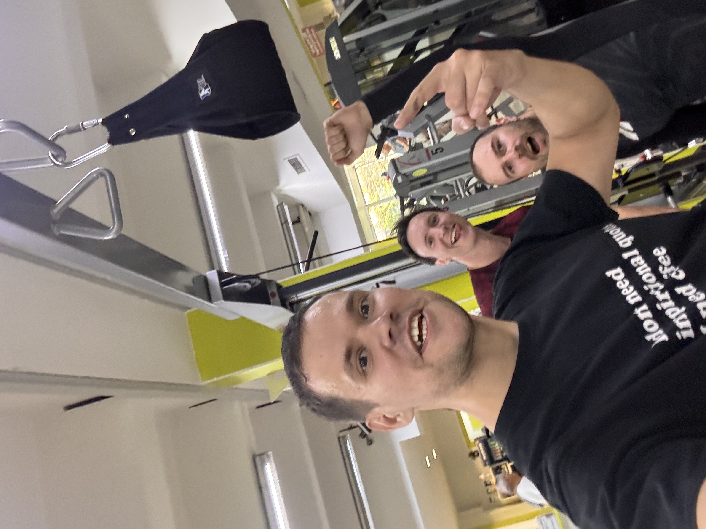
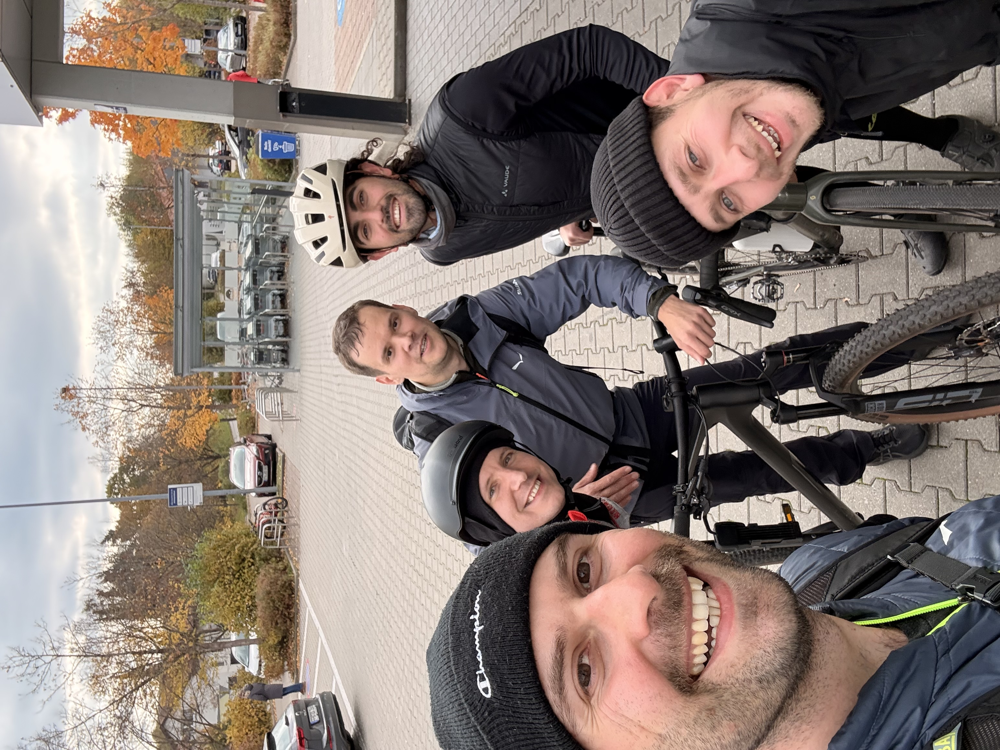

On Saturday, 31 October 2026, four of us spent a whole day on a challenge: Peter, Dima, Alex, and me. I got inspired by this short [Instagram Reel](https://www.instagram.com/reel/DdOzm4Gh5gs/?xtok=Z2duZWMwOHRkZXFl), put the draft challenge plan together and setup our WhatsApp group. That draft has changed a lot. 😁 

The first draft included 100 pull-ups, 200 push-ups, and 300 air squats per person, plus 60 km of biking each, plus 100 3-pointer basketball shots each, plus 2.5 Liter beers each. I generally called it "a day of men power and testosterone but not idiocracy." In the end, the version we did was simpler, and that was for sure the right call.

# The workout

We met at [SPORTS4You](https://sports4you.org/) at 9am on Saturday. The workout was 20 rounds of Cindy: 5 pull-ups, 10 push-ups, and 15 air squats, with a two-hour cap. Scaling was fine. Some of us used bands or ring rows for pull-ups, and push-ups from the knees were allowed.

<video controls playsinline preload="metadata" width="100%" poster="/assets/images/challenge-day-1.jpg" src="/assets/videos/challenge-day-1.mp4"></video>

We finished all 20 rounds in about an hour.

<video controls playsinline preload="metadata" width="100%" poster="/assets/images/challenge-day-2-poster.jpg" src="/assets/videos/challenge-day-2.mp4"></video>

# Sauna and ice buckets

Then we went to the sauna for 10 minutes, followed by ice-cold buckets over our heads. It felt actually so great.

# Bike to the burger

Next came about an hour on the bike to the Starnberger See. We ate at [Stark's Burger](https://starksburger.de/), and it was one of the best burgers I have had in Germany. Worth the ride.

# Bowling

The ride back toward the city took another hour, and this time we were heading for the bowling centre. We had 90 minutes and a 3pm start.

We took two lanes instead of one, since more lanes meant more time for strikes. Nobody objected.

The results: Alex had 11 strikes, Peter had 8, Dmytro had 4, and I had 1. I was not the strike king that day.

# The hiccup

On the ride back, Alex got a flat tire. He and Peter took a taxi, which made some of us a bit late for bowling. Dima and I kept biking, and that took another hour.

Apart from that, everything went fast and easy. The weather was good all day.

# Would I do it again?

Yes. Training, recovery, good food, and some fun made for a great day. I am already interested in similar challenges, so if you have one in mind, let me know.
