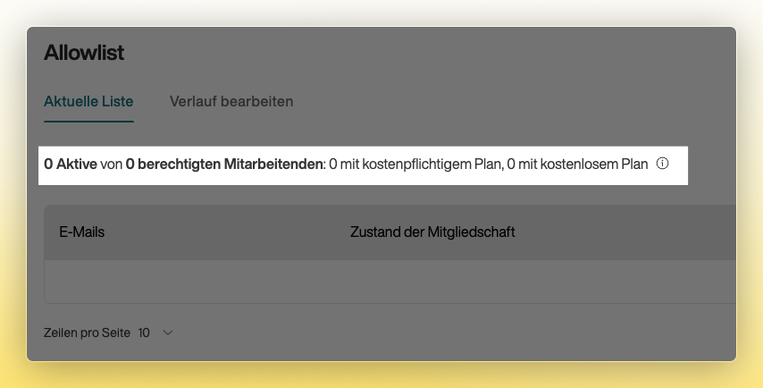
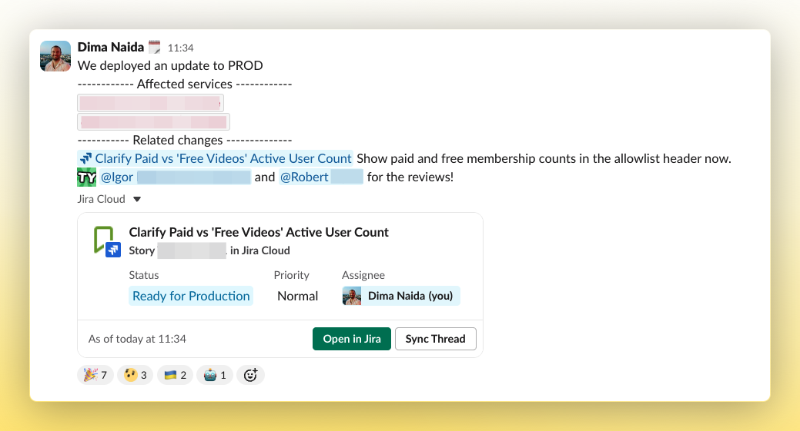

The day has finally come. Today, 10 November 2026, I pushed my change to production on the commercial product I work on as a Product Manager: Company Portal at EGYM Wellpass. 🥳 The change itself is super simple. I added a way for tool admins to tell free and paid memberships apart. But learning the process and seeing my own work go live simply rocks!

I wanted to document the day as a blog post. Why? Because I can, and because it's my very own website. 😁

# The numbers

I wanted to know how long a ticket like this really takes when you start from zero, so I tried to count.

- **Calendar time**: about 8 days, from my first chat with Claude Code on 2 November to the production rollout on 10 November. That's 8 days and 1.5 hours.
- **Claude Code time**: about 5 hours of sessions. A lot of that was Claude working on its own, generating code and running builds and tests, while I waited or did other things. My own active time was roughly half of that.
- **Video calls**: two calls with my engineer colleague, one for setup and one for the testing process. They were booked for 1 hour and 45 minutes in total, and we used less than that.

These are estimates. The session time comes from the timestamps in my chat log, so it includes Claude's background work. I didn't track the time I spent reading documentation or testing in other tools.

This is the release announcement I posted to our team channel:

# Where the time went

The code change was the smallest part. Most of the 8 days went to everything around it:

- **Setting up the environment.** Installing the tools, getting access, and making the project build and run on my laptop.
- **Learning the process.** Branches, pull requests, reviews, and how a change moves from test to production.
- **Testing.** The change had to run in a test environment first. A lot of that was waiting for deployments and checking what was actually live.
- **Signing commits.** Our team requires signed commits before anything goes to production. I created a signing key, added it to GitHub, and re-signed two commits I had already written. This is the step that caught me out.

# What I'd do differently

Set up the environment and learn the commit and signing rules before writing any code. Those two things would have saved the most time, because everything after them depended on them.

I'd also ask about the signing requirement earlier. I only found out when we were ready to release.

And keep a short log of each step. It made the final numbers much easier to reconstruct.

# Would I do it again?

Absolutely. Shipping one small change taught me more about how releases work than writing a dozen tickets ever did. 🚀
